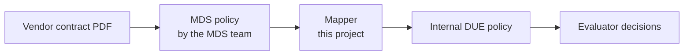

# Turning MDS Vendor Contracts into Internal Policies: Approach and Decisions

2026-09-20 · @Someone

## Summary

Translating vendor contracts from the MDS repository into internal policies is feasible, but it is a translation between two different rulebooks, not a format conversion. We recommend a pipeline whose core is checked independently and which refuses to guess: when a translation cannot be justified, it stops with a clear error instead of producing a policy that might be wrong.

One measurement comes before any building. Someone must check how often the MDS encoding of a contract is actually correct. If users accept that accuracy, we build on MDS and the design below applies. If not, we encode directly from the PDF contracts instead.

- **Goal:** let our internal evaluator make decisions based on vendor contracts held in MDS.
- **Core difficulty:** MDS looks like the ODRL standard but follows its own conventions, and no document says precisely what an MDS policy permits.
- **Approach:** a five-stage pipeline in which simple steps use Python and the translation logic uses a small, strict rule language.
- **Deciding question:** what share of MDS policies faithfully reflect their contracts?

## The task

The request is to make real vendor contracts usable by our internal evaluator, so that it can answer questions such as "may this team use this dataset for this purpose?" Step one is to translate a contract from the MDS repository into an internal consumer contract.

MDS (Market Data Services) stores each vendor contract as a machine-readable policy in the ODRL format, an open standard for expressing what is permitted, forbidden or required. It keeps a link from each encoded rule back to the clause in the original PDF, and it keeps the history of changes as contracts are amended. The internal format, DUE, is a small ODRL profile owned by our team, and our evaluator understands it.

The translation is deliberately lossy. Some content, such as compensation terms and vendor remedies, will not be carried over. Internally, the data team acts as the vendor, with its own service commitments.

Two translations sit between a contract and a decision. The first belongs to the MDS team and the second is ours.

## Why this is hard

MDS uses ODRL's vocabulary but departs from the standard in three ways that change what a policy means. Each one turns a mechanical copy into a judgment call.

**1. Conditions are folded into names.** Standard ODRL states an action ("use") and its conditions ("only for analytics") separately. MDS mostly folds the condition into the name of the action or purpose. Think of a parking sign that reads "Park" with a separate line "weekdays only", versus a sign that reads "Park-weekdays-only", whose relation to "Park" is known only by convention. The mapper has to take such names apart.

**2. Prohibitions sit inside permissions.** "You may enter the building, except the server room" is an exception nested in a permission. Standard ODRL keeps permissions and prohibitions side by side and, as far as we know, has no rule for nesting them. It is unclear whether the exception applies only under that permission or everywhere.

**3. Action families come from a class tree.** ODRL has a defined way to say that one action falls under another. MDS instead relies on a taxonomy of action types. A taxonomy classifies things; it does not say what rights follow. If permission on a parent action automatically covers every child action, then adding a new child to the catalog silently widens every existing contract. We consider this questionable.

The MDS team has an ontology and a validator, but both check vocabulary and structure, not meaning. No document defines what an MDS policy actually permits, and because the policies are descriptive, no enforcement code exists to consult. Two consequences follow:

- We must state our own interpretation of MDS explicitly.
- The contract text is the only final authority on what a policy should say.

## What "safe" means

A safe translation makes three guarantees, and when one cannot be met it fails loudly instead of guessing.

| Guarantee | In plain terms | How it is ensured |
| --- | --- | --- |
| Nothing silently lost | Every element of an MDS policy is translated, dropped on purpose with a stated reason, or stops the process with an error | Compare everything in the input against everything the translation accounted for |
| Same input, same output | One result per policy, and conflicting results for the same slot are reported | Deterministic rules that always finish |
| Never more permissive than the contract | When in doubt, deny | Independent check of each translation (see below) |

The third guarantee reflects an asymmetry: wrongly allowing a use risks a license breach, while wrongly denying one causes friction. So permissions may be narrowed but never widened, and prohibitions may be widened but never narrowed. The first two guarantees can be built into the structure of the translator. The third depends on what the policy means, so it needs a separate check.

## Recommended design

The design is a five-stage pipeline. Simple plumbing stays in Python, and the translation logic is written in a strict rule language so that its behavior can be checked.

| Stage | What it does | Tools |
| --- | --- | --- |
| 1. Read | Loads the MDS policy, checks its structure, and confirms that nothing in the file is left unaccounted for | Python, SHACL (a structure-checking language) |
| 2. Make meaning explicit | Rewrites MDS conventions (folded conditions, nested prohibitions, action tree) into a plain intermediate form. Every interpretation choice is made here and nowhere else | Python |
| 3. Translate | Applies rules that convert the intermediate form into internal policy elements, choosing the cautious side, and produces a report of what was lost | Datalog (a rule language that always terminates) |
| 4. Verify | An independent checker compares the meaning of input and output (see below) | Small, separate checker |
| 5. Write out | Converts the result to the internal format, checks it against the internal structure rules, and loads it into the evaluator | Python, SHACL |

We propose Datalog for stage 3 for three reasons. Its rules read like a mapping specification, so policy experts can review them. It always finishes. And a completeness check can be written in the same language: a rule that lists every input element no translation rule covers, which must be empty. Its limits are that it cannot invent new identifiers, so these are derived from source keys, and that arithmetic or text conversions stay outside it as small pure functions. The engine must also be approved for use in our environment.

### Alternatives considered

- **Typed code with exhaustive matching (Kotlin, Scala or Go).** The compiler enforces that every input case is handled. It needs no new tool but is harder for non-programmers to review. This is the fallback if a Datalog engine is not approved.
- **Formal proof (Dafny or Lean).** Proving properties gives the strongest assurance at high cost. We would reserve it for a small critical piece, such as the table that maps conditions, not the whole mapper.

## Handling ambiguity

Because MDS has no official meaning, we treat each open interpretation question as an explicit setting, and only translate what is safe under every plausible answer. Three decisions matter most:

| Decision | Readings to consider |
| --- | --- |
| Nested prohibition | An exception inside its permission only, or a prohibition in force everywhere, where deny wins |
| Action tree | Exact action only, or permissions and prohibitions both extend to every child action |
| Condition folded into a name | A restriction on an otherwise general action, or a distinct narrower action with no link to its parent |

A "reading" is one choice for each decision. The translator treats something as permitted only if every reading permits it, and as forbidden if any reading forbids it. Policies whose outcome is the same under all readings translate automatically. The others stop with a message naming the decision they depend on.

Counting how many policies each decision affects gives a ranked question list. The most valuable questions can then go to the MDS team, and decisions no real policy depends on can be ignored. One risk is that widely diverging readings could push results toward "deny everything". The loss report makes this visible and shows what settling each decision would gain.

### How ambiguity shows up in the result

1. **Cautious translation (start here).** Ambiguous cases translate to the deny side. Every rule carries the MDS element and contract clause it came from, plus a flag saying whether it is explicit in the contract or the result of ambiguity. Without the flag, a denial caused by ambiguity would look like a denial the contract demands.
2. **Carry the doubt into the evaluator (later).** The evaluator answers "indeterminate" and names the decision and clause involved. This needs a small extension to the internal format but can be added on top of the first option.

**Settling decisions.** Since the contract is the final authority, a domain reviewer reads the clause for contracts where the readings diverge. Each ruling removes options permanently and becomes a regression test.

## Checking the result

Every translation is verified by a separate, small checker, so the translator itself does not have to be trusted. The idea is that of an auditor who recomputes the totals instead of trusting the accountant.

For each policy, the checker asks the same set of test requests of both the MDS policy and the translated one, and confirms that the translation never allows something the MDS policy might not. Since MDS rarely uses conditions, the space of possible requests (action, purpose and so on) is finite. That lets the checker try all combinations instead of a sample. Anything outside what the checker can decide, or any violation, stops the process with an error.

Two boundaries keep the result honest:

- **Internal facts are supplied, not invented.** The internal contract needs facts that MDS does not contain, such as internal roles and service levels. The mapper depends only on the MDS policy, and these facts arrive as a separate input.
- **Build a thin slice first.** Take three to five contracts that cover each of the tricky patterns, with expected decisions ruled on by a reviewer. Run them end to end through the evaluator before generalizing.

## The deciding question: how accurate is MDS?

MDS is a third party's reading of each contract, so the whole project rests on how faithful that reading is. Before building anything, measure it. A reviewer draws a sample of contracts and compares each MDS encoding with its PDF. Because MDS links every rule to its clause, this is much cheaper than it sounds. Zero errors in 30 contracts bounds the true error rate at roughly 10% with 95% confidence.

The result decides which path we take:

| Outcome | Path |
| --- | --- |
| Users accept the measured accuracy | Use MDS as the source. Build the pipeline described above, with the interpretation rulings and the loss report |
| Users do not accept it | MDS cannot be the source. Encode the contracts directly from the PDFs, or have the MDS team correct their policies first |

Two cautions apply. First, agree on the acceptance threshold with users before measuring, and count error types separately, because wrongly allowing a use is worse than wrongly denying one. Second, accuracy here means meaning, not vocabulary or structure. A policy can pass the MDS validator and still misstate its contract.

**Contracts change over time.** MDS keeps a linked history of each contract's amendments. We have not yet discussed how to handle this, but we propose the following:

- Translate each version separately, and record which contract version a result came from.
- Re-run the translation when a new version appears, and compare it with the previous result.
- Re-review any ruling whose contract clause has changed.

## Next steps and open questions

The first three steps decide the path, and the rest apply if we build on MDS.

1. Agree with users what accuracy is acceptable, with wrongly allowed and wrongly denied uses counted separately.
2. Draw a sample of about 30 contracts and measure how faithfully MDS encodes them, using the clause links.
3. Choose the path: build on MDS, or encode directly from the PDFs.
4. Write down the interpretation decisions, rank them by how many policies they affect, and collect reviewer rulings.
5. Build a thin slice of three to five contracts end to end, through the evaluator.
6. Generalize, following the same order: specify a construct, test it against the ruled cases, then implement it.

### Open questions

- What accuracy threshold will users accept?
- Is a Datalog engine approved for use in our environment, or do we fall back to typed code?
- Who supplies the internal facts (roles, service levels) that MDS does not contain?
- Is the proposed handling of contract history acceptable?
- Do we send the MDS team a report on where their profile departs from the ODRL standard? It would give them evidence, but their cooperation is not required for the plan.

## Glossary

| Term | Meaning |
| --- | --- |
| ODRL | An open standard for describing, in machine-readable form, what is permitted, forbidden or required when using an asset such as data |
| Profile | A variant of ODRL that adds its own vocabulary and conventions for a particular domain |
| MDS | Market Data Services: the repository of vendor contracts, each encoded as a policy in its own ODRL profile |
| DUE | Our internal ODRL profile for internal data-usage policies, together with the evaluator that decides requests against it |
| Evaluator | The engine that takes a policy and a request (who, what, why) and returns a decision |
| Condition (constraint, refinement) | A restriction on when a rule applies, such as a purpose or a date |
| Action tree | A taxonomy of action types in which some actions are kinds of others |
| SHACL | A language for checking that data has the required structure. It checks form, not meaning |
| Datalog | A rule language whose programs always finish and behave the same way every time |
| Reading | One complete set of answers to the interpretation questions about MDS |
| Loss report | A record, produced with every translation, of what was dropped or approximated and why |
